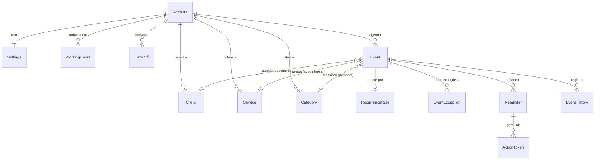
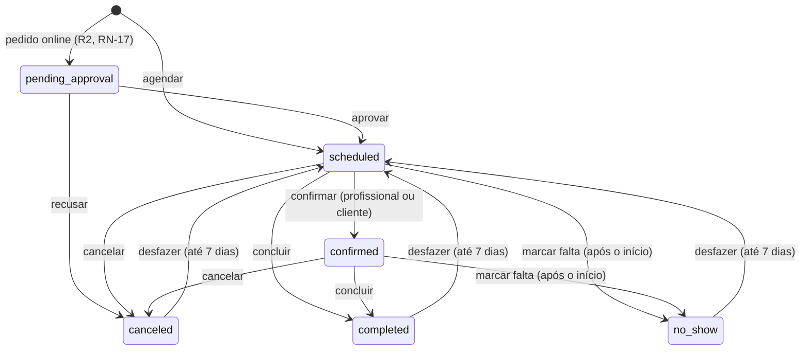

# Modelo de domínio — Agenda

- **Versão do documento:** 0.1
- **Data:** 2026-11-04

Voltar para o índice: [README.md](README.md)

Modelo conceitual (não é o esquema do banco). Nomes das entidades em inglês,
como ficarão no código (`types.ts` de cada módulo, ADR-0025). Decisão de
modelagem em [ADR-0048](../decisions/ADR-0048-evento-unico-e-conta-individual.md).

---

## 1. Diagrama (MVP)



## 2. Entidades

| Entidade         | Descrição                                                                     | Atributos principais                                                                                                                                                                            |
| ---------------- | ----------------------------------------------------------------------------- | ----------------------------------------------------------------------------------------------------------------------------------------------------------------------------------------------- |
| `Account`        | A conta do usuário (no MVP, uma pessoa = uma conta).                          | `id`, `name`, `email`, `emailVerifiedAt`, `usageMode` (`personal` \| `professional`), `createdAt`, `deletedAt`                                                                                  |
| `Settings`       | Preferências da conta.                                                        | `timeZone` (IANA), `locale`, `weekStartsOn`, `hourFormat`, `defaultReminderOffsets`, `reminderTemplate`, `dailySummaryAt`                                                                       |
| `Client`         | Pessoa atendida pelo profissional. Não tem login.                             | `id`, `name`, `phone`, `email`, `birthDate`, `notes`, `reminderConsentAt`, `archivedAt`, `anonymizedAt`                                                                                         |
| `Service`        | O que o profissional oferece.                                                 | `id`, `name`, `durationMinutes`, `bufferMinutes`, `price`, `hue` (cor de evento), `modality` (`in_person` \| `online` \| `home`), `defaultLocation`, `active`                                   |
| `Category`       | Classificação de compromissos pessoais.                                       | `id`, `name`, `hue`                                                                                                                                                                             |
| `WorkingHours`   | Intervalo de trabalho num dia da semana.                                      | `weekday` (0–6), `startTime`, `endTime` (horas locais)                                                                                                                                          |
| `TimeOff`        | Bloqueio de disponibilidade.                                                  | `id`, `startsAt`, `endsAt`, `allDay`, `reason`                                                                                                                                                  |
| `Event`          | Qualquer coisa na agenda. `kind` diz se é compromisso pessoal ou atendimento. | `id`, `kind` (`personal` \| `appointment`), `title`, `startsAt`, `endsAt`, `allDay`, `location`, `description`, `status`, `travelMinutesBefore`, `price`, `clientId`, `serviceId`, `categoryId` |
| `RecurrenceRule` | Regra de repetição (RFC 5545).                                                | `rrule` (ex.: `FREQ=WEEKLY;BYDAY=TU`), `until`, `count`, `timeZone`                                                                                                                             |
| `EventException` | Ocorrência alterada ou cancelada de uma série.                                | `originalStart`, `override` (campos alterados) ou `canceled`                                                                                                                                    |
| `Reminder`       | Lembrete programado para um evento.                                           | `id`, `channel` (`email` \| `push` \| `whatsapp`), `recipient` (`client` \| `owner`), `sendAt`, `state` (`scheduled` \| `sent` \| `failed` \| `canceled`), `error`                              |
| `ActionToken`    | Token de uso único para o cliente confirmar ou cancelar sem login.            | `token` (hash), `eventId`, `occurrenceStart`, `expiresAt`, `usedAt`                                                                                                                             |
| `EventHistory`   | Trilha de alterações relevantes (status, remarcação, cancelamento).           | `at`, `actor` (`owner` \| `client` \| `system`), `change`, `reason`                                                                                                                             |

Na evolução entram `BookingPage` e `BookingRule` (R2), `CalendarConnection`
(R2), `Payment`, `Package`, `SessionNote`, `Attachment` (R3), `WaitlistEntry`
(R4), `Member`, `Role` e `Resource` (R5).

## 3. Ciclo de vida do atendimento (RN-05)



Compromissos pessoais (`kind = personal`) não têm status: existem ou são
excluídos.

## 4. Cálculo de horários livres (RN-02, RN-03)

```text
livre(dia, serviço) =
    intervalos de WorkingHours do dia
  − TimeOff
  − eventos `appointment` ativos (início − deslocamento … fim + intervalo do serviço)
  − (opcional) compromissos pessoais marcados como "ocupado"
  → fatias onde cabe duração + intervalo do serviço, em passos de 15 min
```

O cálculo é do backend (uma fonte de verdade para a agenda, a sugestão de
horários e a página pública); o frontend só exibe.

## 5. Glossário

| Termo               | Significado                                                              |
| ------------------- | ------------------------------------------------------------------------ |
| Atendimento         | Evento com cliente e serviço (`kind = appointment`).                     |
| Compromisso pessoal | Evento sem cliente (`kind = personal`).                                  |
| Evento              | Qualquer item da agenda: atendimento ou compromisso.                     |
| Ocorrência          | Uma das datas de um evento recorrente.                                   |
| Série               | O conjunto das ocorrências de um evento recorrente.                      |
| Encaixe             | Atendimento marcado fora do horário de trabalho ou num bloqueio (RN-03). |
| Bloqueio            | Período sem disponibilidade (folga, férias, feriado).                    |
| Intervalo (buffer)  | Tempo reservado depois do atendimento, definido no serviço.              |
| Deslocamento        | Tempo reservado antes do atendimento para chegar ao local.               |
| Falta (no-show)     | O cliente não compareceu.                                                |
| Horário livre       | Fatia da disponibilidade onde cabe um serviço (seção 4).                 |
| Profissional        | Usuário no modo profissional, dono da conta.                             |
| Cliente             | Pessoa atendida; não tem login.                                          |
